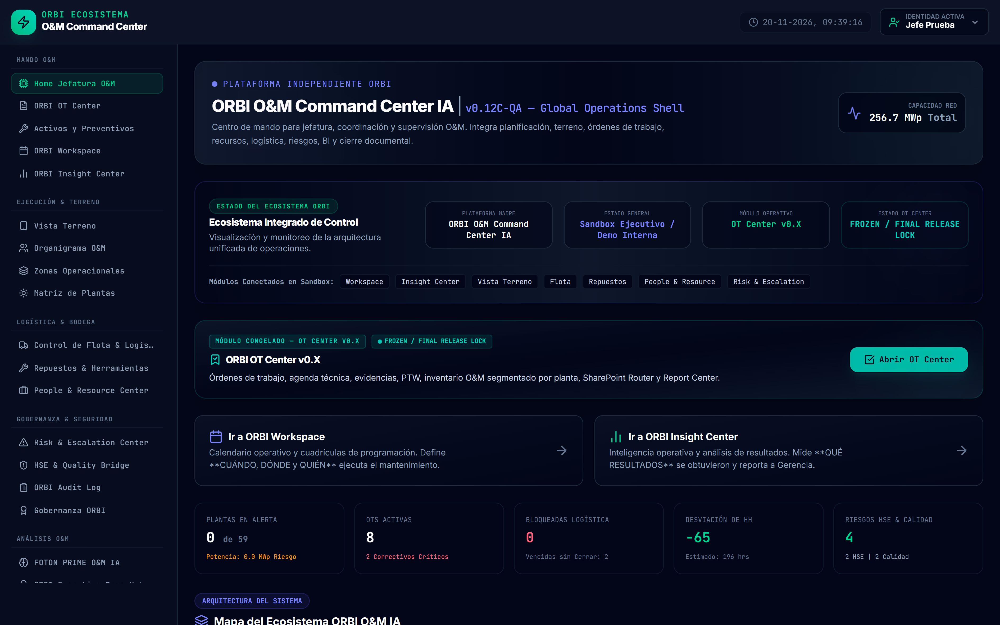
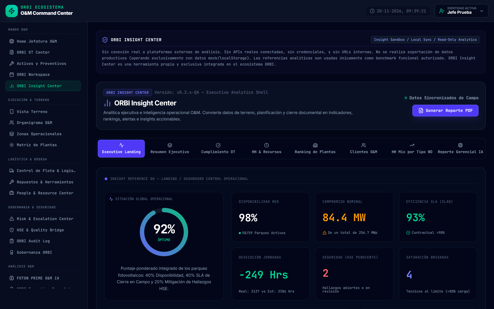
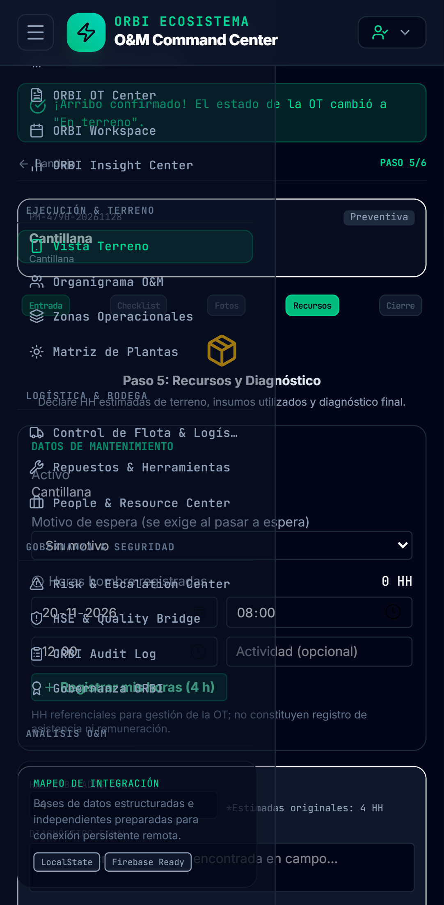
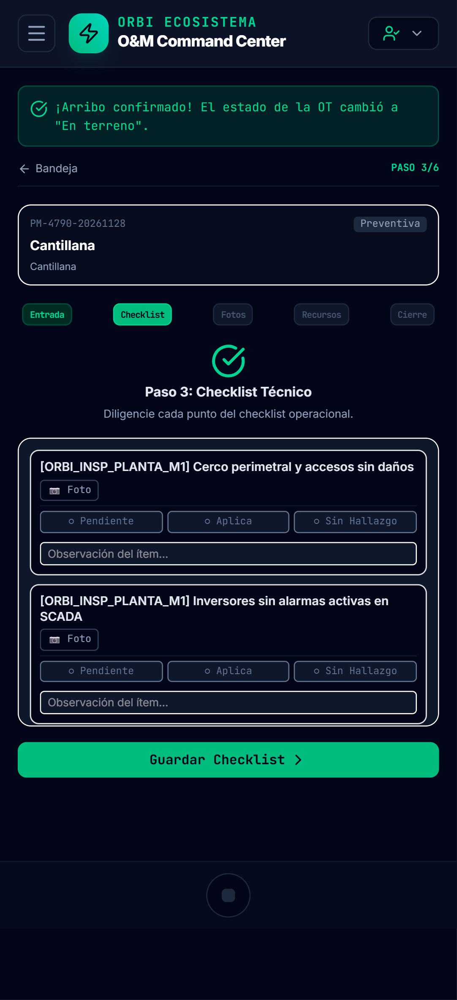

# ORBI — Auditoría UX/UI para nivel premium

Fecha: 2026-11-20 · Rama `feat/piloto-17a` · Método: tres auditorías en paralelo con agentes y skills de ECC (diseño visual con `design-system` y `make-interfaces-feel-better`, accesibilidad con `a11y-architect`, rendimiento con `performance-optimizer`) más capturas reales en teléfono (Pixel 7) y PC (1440 px). Solo lectura: no se modificó la app.

## Veredicto

La base funcional es sólida, pero la interfaz todavía **se ve como una demo técnica**, no como un producto premium. Los tres problemas que más se notan frente a gerencia y en terreno:

1. **Jerga interna y textos falsos a la vista** — "FROZEN / FINAL RELEASE LOCK", "Sandbox Ejecutivo / Demo Interna", "Mock", "v0.12C-QA — Global Operations Shell", "Firebase Ready", "datos mock/localStorage", asteriscos de Markdown sin procesar (`**CUÁNDO, DÓNDE y QUIÉN**`), y "Real: 3137 Hrs" (contradice la regla de no hablar de "horas reales").
2. **Fallas visibles de terminación** — el menú lateral del teléfono es transparente y se superpone al contenido; 403 bordes y fondos usan un color que no existe (`slate-850`) y no se dibujan; la tipografía de títulos (Space Grotesk) nunca se carga.
3. **Ilegible para el técnico al sol y con guantes** — 1.643 textos de 6 a 10 px, texto gris de bajo contraste en 990 lugares, botones del checklist de ~16 px de alto.

## Puntaje de diseño (0–10)

| Dimensión | Nota | Motivo principal |
|---|---|---|
| Coherencia de color | 3 | 445 clases de color distintas en 15 familias, sin tokens; el error es a veces rose y a veces red |
| Jerarquía tipográfica | 2 | Space Grotesk no se carga; 1.858 tamaños arbitrarios `text-[Npx]` |
| Ritmo de espaciado | 6 | Mayormente la escala de Tailwind |
| Consistencia de componentes | 3 | 37 variantes de botón sólido en 50 botones; 6 radios mezclados |
| Adaptación a teléfono | 5 | Vista Terreno ya ocupa la pantalla, pero el menú se rompe y hay textos de 7–9 px |
| Modo oscuro / claro | 3 | Solo oscuro; sin tema de alto contraste para el sol |
| Movimiento | 3 | 80 animaciones de adorno (pulse, ping, bounce) |
| Accesibilidad | 2 | Contraste insuficiente, foco invisible, campos sin etiqueta |
| Densidad de información | 4 | 873 textos en MAYÚSCULAS y 1.888 en letra de código |
| Pulido | 4 | 411 clases inexistentes y 219 emojis en la interfaz |

**Promedio: 3,5 / 10.**

## Rendimiento en teléfono

| Medida | Valor |
|---|---|
| JavaScript de la app (un solo archivo) | 1.825 kB (397 kB comprimido) |
| CSS | 144 kB (20 kB comprimido) |
| Tiempo de descarga estimado en 3G débil | ~8 s antes de mostrar algo |

El técnico descarga los 22 módulos aunque solo usa Vista Terreno. Además, un reloj en la cabecera vuelve a dibujar toda la app cada segundo, y cada cambio guarda la lista completa de OTs de forma bloqueante.

## Hallazgos por prioridad

### P0 — Antes de mostrar a gerencia (1 a 2 días)

| # | Hallazgo | Dónde | Propuesta |
|---|---|---|---|
| 1 | Menú lateral transparente en el teléfono | `src/App.tsx:583` (dos fondos en conflicto) | Fondo sólido, capa oscura detrás, cierre con Escape |
| 2 | Jerga interna, versiones y textos falsos | Inicio, Insight Center, OT Center, menú | Quitar estados "FROZEN", "Sandbox", "Mock", versiones y "Firebase Ready"; corregir "Real" por "HH registradas" |
| 3 | 403 bordes y fondos invisibles (`slate-850`) | 325 `border-slate-850`, 36 `bg-slate-850`, 42 `border-zinc-850` | Definir el tono en el tema |
| 4 | Tipografía de títulos no cargada y fuentes desde Google (fallan sin señal) | `src/index.css:1` | Fuentes locales (Inter, Space Grotesk, JetBrains Mono) |
| 5 | Notas de arquitectura y decorados de "teléfono simulado" a la vista | `VistaTerreno.tsx:1384`, botón de inicio falso al pie | Eliminar |
| 6 | Asteriscos de Markdown sin procesar | `HomeEjecutivo` | Texto con negrita real |

### P1 — Terreno legible y usable con guantes (3 a 5 días)

| # | Hallazgo | Propuesta |
|---|---|---|
| 7 | Botones del checklist de ~16 px y pasos de 20 px con letra de 8 px | Mínimo 44 px de alto y 14 px de letra en Vista Terreno |
| 8 | Contraste insuficiente (slate-500/600 sobre fondo oscuro) | Gris mínimo slate-400 y etiquetas slate-300 |
| 9 | Sin tema claro para pleno sol | Tema "Terreno" de alto contraste, activable por el técnico |
| 10 | Más de 20 `alert()` y 3 `prompt()` nativos | Avisos propios con errores junto al campo |
| 11 | Campos sin etiqueta, tarjeta de OT no accesible, foto oculta del teclado | Etiquetas reales, botones verdaderos, foco visible |
| 12 | Checklist con código de plantilla al inicio (`[ORBI_INSP_PLANTA_M1] …`) y botones que muestran el estado en vez de la acción | Código en gris pequeño; botones "Hecho / No aplica / Hallazgo" con estado claro |

### P2 — Sistema de diseño y rapidez (1 a 2 semanas)

| # | Hallazgo | Propuesta |
|---|---|---|
| 13 | Paleta sin sistema | Tokens de marca y de estado (ok, alerta, peligro, info) con un acento único |
| 14 | 37 variantes de botón | Componente `Botón` con 4 variantes y 3 radios |
| 15 | 219 emojis y 80 animaciones decorativas | Íconos Lucide; movimiento solo para estados vivos y respeto de "reducir movimiento" |
| 16 | MAYÚSCULAS + letra de código en todas las etiquetas | Letra de código solo para códigos de OT y series (regla de `AGENTS.md`) |
| 17 | Inglés mezclado ("Evidence Vault", "Field Ops", "People & Resource Center", "Wizard") | Glosario en español |
| 18 | Carga inicial de 397 kB comprimidos | Cargar cada módulo bajo demanda: el técnico baja a ~120 kB (−70 %) |
| 19 | Re-dibujo completo cada segundo y guardado bloqueante | Reloj aislado y guardado diferido |

## Estado de P0 (corregido el 2026-11-20)

| # | Corrección |
|---|---|
| 1 | Menú del teléfono: panel sólido, capa oscura detrás, cierra con Escape o tocando fuera, botón de cierre con nombre accesible y página actual marcada. Etiquetas del menú en Inter (no en letra de código). |
| 2 | Inicio: sin "FROZEN", "Sandbox Ejecutivo", "v0.X", "v0.12C-QA", ni "Firebase Ready"/"LocalState". Monitoreo SCADA rotulado como "aún no conectado". Insight Center: aviso breve y veraz ("Indicadores de referencia…"), sin versión ni prefijos "Insight Reference NN"; "Real" → "Registradas". OT Center y PTW: sin "Mock" ni "Wizard" ("Nueva OT", "Archivo SharePoint (simulado)"). |
| 3 | Tono `slate-850` y `zinc-850` definido en el tema: los 403 bordes y fondos ahora se dibujan. |
| 4 | Fuentes empaquetadas con la app (Inter, Space Grotesk y JetBrains Mono, funcionan sin señal); títulos h1/h2 en Space Grotesk. |
| 5 | Vista Terreno: sin "Nota de Arquitectura", sin "Mobile-First Field Application" y sin el botón de inicio dibujado en el teléfono real. |
| 6 | Asteriscos de Markdown reemplazados por negrita real (Inicio, Insight Center, Demo Hub). |

Antes y después: `docs/auditoria-ux/` (antes) y `docs/auditoria-ux/despues-p0/` (después).

## Estado de P1 (corregido el 2026-11-20)

| # | Corrección |
|---|---|
| 7 | Checklist con botones de 44 px ("Hecho", "No aplica", "Hallazgo") que muestran su estado; pasos de 44 px que caben en el teléfono; pregunta en 16 px y código de plantilla aparte en pequeño. Ningún texto de Vista Terreno bajo 12 px (91 corregidos; verificado por prueba automática). |
| 8 | Grises de texto secundario aclarados en toda la app para cumplir contraste AA (slate-500 ~5,5:1, slate-600 ~4,5:1). |
| 9 | **Modo sol**: tema claro de alto contraste en Vista Terreno, con botón en la bandeja y en cada OT; se recuerda en el teléfono. |
| 10 | 54 `alert()` reemplazados por avisos propios (abajo, legibles, anunciados por lector de pantalla, los errores duran más). |
| 11 | Foco visible para teclado en toda la app; tarjeta de OT operable con teclado; fotos con input accesible; campos de checklist, HH y codificación de falla con etiqueta; respeto de "reducir movimiento". Se quitó el texto de "coordenadas simuladas" y la nota de GPS futuro. |
| 12 | Botones del checklist con la acción ("Hecho") y su estado (`aria-pressed`), no el estado al revés ("Pendiente"). |

Antes y después: `docs/auditoria-ux/` (antes) y `docs/auditoria-ux/despues-p1/` (después).

## Estado de P2 (corregido el 2026-11-20)

| # | Corrección |
|---|---|
| 13 | Tokens de estado en el tema (`accent`, `ok`, `warn`, `danger`, `info`, `surface`, `line`, `ink`, `radius-control`, `radius-card`), que siguen al Modo sol. Un solo acento (esmeralda); el error es siempre rose. |
| 14 | Componente `Button` (`src/components/ui/Button.tsx`): 4 variantes (principal, secundaria, peligro, discreta), 44 px de alto por defecto. Adoptado en inicio de sesión, error de módulo, registro de HH, pasos de Vista Terreno (confirmar llegada, guardar checklist, solicitar cierre, registrar bloqueo) y acciones de supervisión. |
| 15 | Emojis cambiados por íconos Lucide o eliminados en Vista Terreno, en las pestañas de OT Center y en el aviso de error de la cabecera. |
| 16 | Vista Terreno: letra de código solo en códigos de OT y de plantilla (65 etiquetas pasan a Inter, sin MAYÚSCULAS forzadas). |
| 17 | Glosario en español: menú ("Personas y Carga de Trabajo", "Riesgos y Escalamientos", "HSE y Calidad", "Registro de Auditoría", "Inicio Jefatura O&M", "Presentación Ejecutiva", "Preparación de Demo"); pestañas de OT Center ("Órdenes de trabajo", "Programación", "Evidencias", "Permisos de trabajo", "Cierre documental"); Insight ("Vista general", "HH por tipo de OT"); Vista Terreno ("Confirmar llegada", "Paso 4: Fotos de evidencia", "Mi ejecución", "Supervisión"). Se mantienen las marcas ORBI OT Center, Workspace e Insight Center. |
| 18 | Cada módulo se descarga al abrirlo. **El técnico descarga 164 kB comprimidos en vez de 417 kB (−61 %).** Tras iniciar sesión, los módulos de su rol se descargan en segundo plano para tenerlos sin señal. |
| 19 | El reloj de la cabecera tiene su propio estado y cambia cada 30 s (antes re-dibujaba toda la app cada segundo). La copia de las OTs en el teléfono se guarda 800 ms después del último cambio y de inmediato al pasar a segundo plano; la consulta periódica al servidor no re-dibuja si nada cambió. |

Correcciones encontradas al probar P2:

- El service worker borraba los archivos que la página no nombraba directamente; con la carga por módulo, eso habría borrado Vista Terreno y el técnico no podría abrirla sin señal. Ahora recorre en cadena los archivos que usa la versión vigente (`public/sw.js`, caché `orbi-shell-v3`).
- Sin señal, la app abría en "Inicio" en lugar de la vista del rol; ahora abre igual que con señal.
- Si un módulo nunca abierto no está disponible sin señal, se explica en español (antes, un error técnico en inglés).
- Prueba automática nueva (paso 8 de `tests/e2e/piloto.spec.ts`): el técnico abre la app desde cero sin señal y ve sus OTs.

Pendiente para llegar a ~120 kB: el núcleo de la app todavía incluye el catastro de 59 plantas y el organigrama (`src/data/db.ts`); separarlos es un cambio de datos mayor.

Capturas: `docs/auditoria-ux/despues-p2/`.

## Capturas

| PC — Inicio | PC — Insight Center | Teléfono — menú | Teléfono — checklist |
|---|---|---|---|
|  |  |  |  |

## Recomendación

Hacer **P0 completo** antes de cualquier presentación (es barato y es lo que más se nota), luego **P1** antes de entregar teléfonos a técnicos, y **P2** como fase de "sistema de diseño ORBI". Cada fase se valida con `npm test`, `npm run e2e` y nuevas capturas comparadas contra estas.
