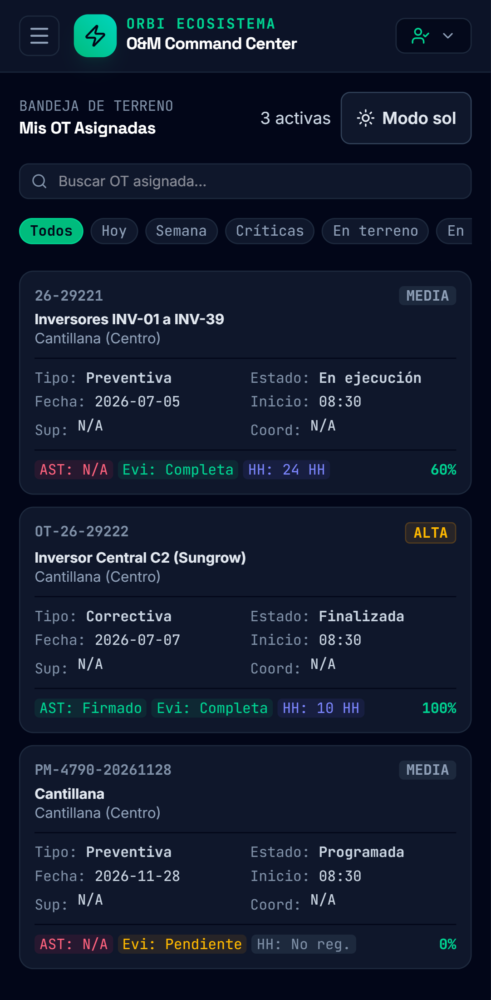
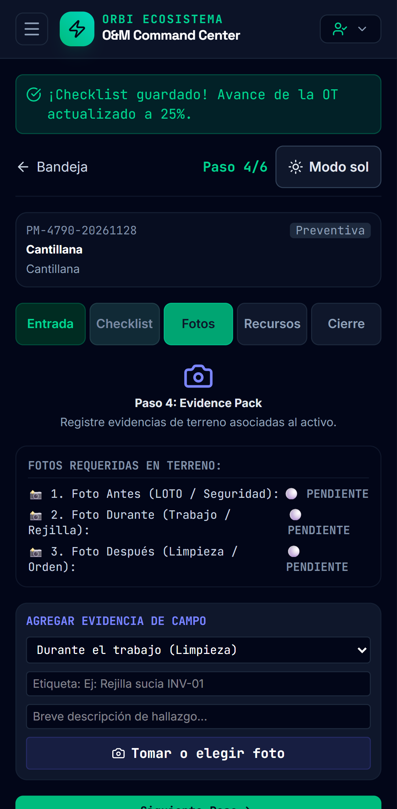
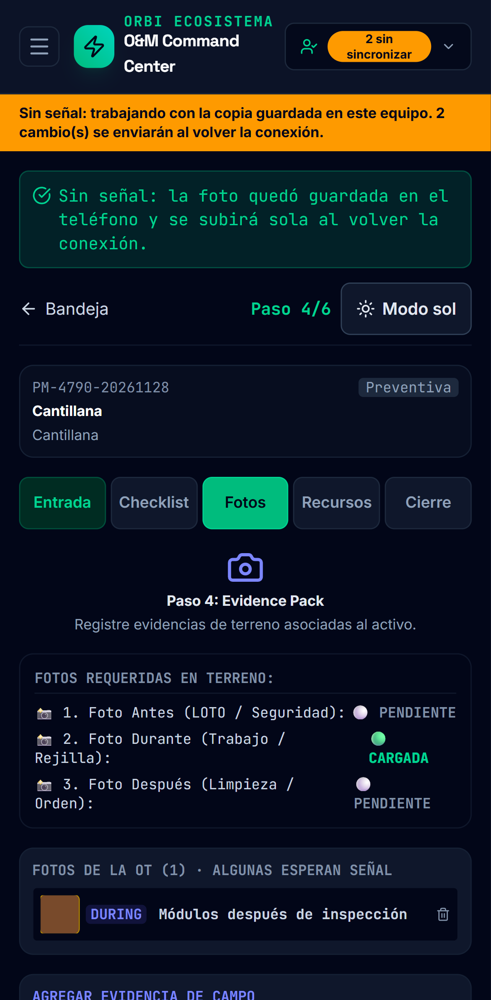
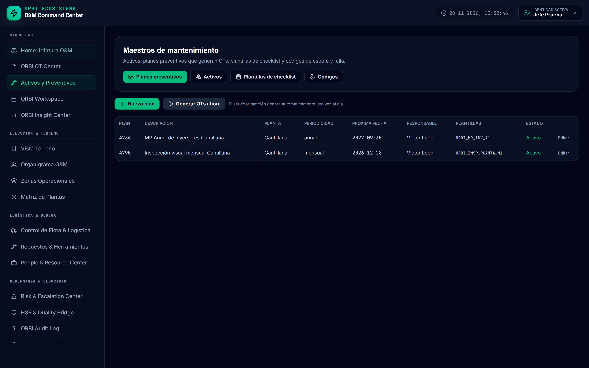

# ORBI — Piloto 17A: prueba de punta a punta

Qué se probó, cómo repetirlo antes de cada presentación y qué mostrar a gerencia.

## Resumen

El piloto cubre el ciclo completo de una OT, igual al flujo que hoy se hace en SoftWrench, con usuarios reales y reglas que el servidor hace cumplir:

| Paso | Quién | Equivalente SoftWrench |
|---|---|---|
| El plan preventivo genera la OT 30 días antes | Sistema | PM → WO (DAPPR) |
| Llegada a planta, AST, inicio de ejecución | Técnico (teléfono) | INPROG |
| Espera con motivo codificado (p. ej. repuesto) | Técnico | HOLD |
| Checklist de plantilla con valores, rangos y foto por pregunta | Técnico | Formularios por plantilla |
| Horas hombre por técnico | Técnico | Labor |
| Consumo de repuesto con descuento de stock de la planta | Técnico | Material |
| Ejecutada en terreno | Técnico | FDCOMP |
| Revisión: Supervisor → Coordinador → Jefe O&M | Supervisión | RSALOR |
| Cierre (correctivas exigen codificación de falla) | Supervisión / Jefatura | CLOSED |

## Las dos pruebas automáticas

### 1. Prueba de servidor (`tests/e2e-api.test.ts`, 16 pasos, dentro de `npm test`)

Con cuatro usuarios (técnico, supervisor, coordinador y Jefe O&M) recorre:

- **Preventivo Cantillana:** el plan anual 4736 genera `PM-4736-20270930` una sola vez → el técnico la ejecuta con 8 preguntas de checklist (2 numéricas, 4 con foto obligatoria), 8 HH en dos tramos y evidencia → firmas Supervisor, Coordinador y Jefe O&M → cerrada. Verifica que cada paso del historial quede con el nombre real de quien lo hizo.
- **Correctivo Cantillana (inversor central C2):** el supervisor crea la OT → el técnico la deja "En espera de repuesto" (motivo REPUESTO) → consume el fusible de potencia de la bodega de Cantillana (stock descontado y movimiento registrado) → repara con fotos antes/después → el cierre se rechaza hasta codificar la falla (INV-OFF / FUSIBLE / REEMPLAZO) → cerrada.
- **Reglas que no se pueden saltar:** un técnico no cierra OTs, no firma como supervisor, no crea OTs, no ve ni modifica OTs de otros técnicos, no borra movimientos de inventario y no ve la auditoría.

### 2. Prueba de pantallas (`tests/e2e/piloto.spec.ts`, Playwright con Microsoft Edge)

Un técnico en un teléfono y el Jefe O&M en un PC, operando las pantallas como una persona:

1. El técnico entra y ve solo sus OTs, a pantalla completa en el teléfono.
2. Abre la OT preventiva generada por el plan mensual y confirma su llegada.
3. Responde el checklist: una irradiancia de 1550 W/m² queda marcada "fuera de rango" y como hallazgo; agrega la foto obligatoria de una pregunta.
4. Registra sus horas.
5. **Pierde la señal**, saca una foto de evidencia: queda guardada en el teléfono con el aviso "Sin señal" → **vuelve la señal** y todo se sincroniza solo.
6. El Jefe O&M ve los planes preventivos y, en el servidor, el trabajo del técnico con su nombre en el historial y en la auditoría.

## Cómo repetirlas

```powershell
npm test
```

```powershell
npm run e2e
```

`npm run e2e` compila la versión de producción, levanta un servidor con una base temporal (no toca `data/`) y abre Edge. El informe queda en `playwright-report/index.html` y las capturas de cada paso en `test-results/piloto/`.

## Capturas (técnico en el teléfono)

| Bandeja del técnico | Checklist | Sin señal | Jefe O&M |
|---|---|---|---|
|  |  |  |  |

## Hallazgos de la prueba que se corrigieron

- **Vista Terreno en un teléfono real** mostraba un teléfono dibujado dentro de la pantalla, con títulos y notas encima; la bandeja empezaba a mitad de pantalla. Ahora ocupa la pantalla completa (en PC se ve igual que antes).
- **La auditoría hecha sin señal se perdía.** Ahora queda en la cola y se envía al volver la conexión, con la hora real del evento.

## Pendiente de datos (no es un error del sistema)

- La bodega demo de Cantillana no tiene **tarjetas de control** de inversor (sí tiene el fusible de potencia, que el caso correctivo también admite). Con el inventario real cargado, el mismo flujo funciona con la tarjeta.
